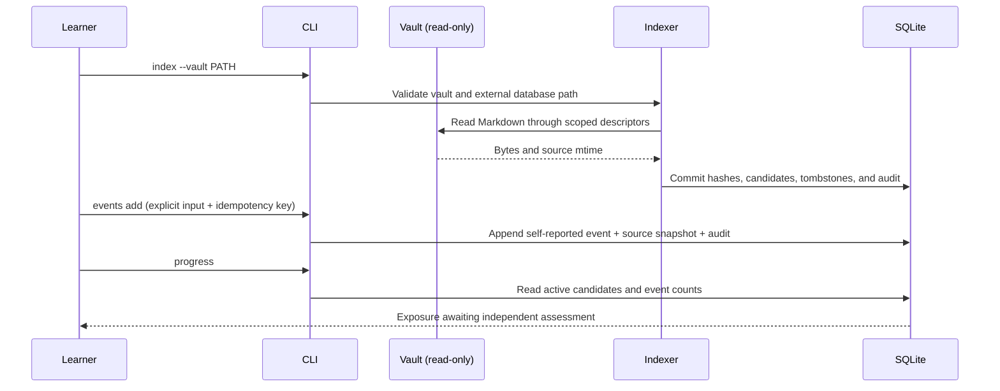

# StudyBuddy

**Having notes isn't the same as knowing.**

StudyBuddy is a local-first learning ledger for software and AI engineering learners.
Read an Obsidian vault without changing it, extract source-backed concept candidates,
and see what you have encountered but have not independently demonstrated.

**Alpha · Python CLI · MIT · offline runtime · no model or account required**

[中文说明](README.zh-CN.md) · [Architecture](docs/ARCHITECTURE.md) ·
[Roadmap](docs/ROADMAP.md) · [Contributing](CONTRIBUTING.md)

## Try the demo

Requires Python 3.12+ on **macOS or Linux**, SQLite with FTS5, and
[uv](https://docs.astral.sh/uv/getting-started/installation/).
Run these commands from this checkout. There is no published PyPI package yet.

```sh
uv sync --locked
uv run --offline python examples/demo.py
```

The first command downloads dependencies. The demo then runs offline against three
original synthetic notes, creates a temporary database outside the vault, and removes
that database on exit. It demonstrates import, a repeated import, an explicit copied-AI
event, an idempotent retry, and a progress query.

Actual demo summary (concept IDs vary between fresh databases):

```text
Copied AI answer: created=True; repeated key: created=False

6 active concept candidates
6 awaiting independent assessment
0 verified mastered (assessment evaluator is not implemented in Sprint 1)
```

## What works today

| Command | Result |
| --- | --- |
| `studybuddy doctor --vault PATH` | Count visible Markdown files; no note-body reads or database creation |
| `studybuddy index --vault PATH` | Incrementally index hashes, versions, frontmatter, headings, and Wikilinks |
| `studybuddy concepts list` | Inspect `seen` candidates with source path, heading, line, hash, and timestamps |
| `studybuddy concepts list --search "TCP retries"` | Literal FTS5 phrase search over active headings and paths |
| `studybuddy events add ...` | Append an explicit, validated, self-reported learning event once |
| `studybuddy events list` | Inspect event history and the source snapshot recorded at event time |
| `studybuddy progress` | List exposure without independently verified assessment |

This is **Sprint 1**, not the entire product vision. There is no assessment evaluator
yet, so every concept remains a candidate with status `seen`. Even a self-reported
recall or practice attempt does not become verified mastery. Quiz grading, concept
confirmation/merging, MCP, spaced review, vocabulary, and the React UI are future work.

## Use your own vault

`--db` is a global option: put it **before** the subcommand. A database belongs to
one resolved vault root. Choose a different database for a second vault.

```sh
uv run --offline studybuddy --db .local/study.sqlite3 doctor --vault /absolute/path/to/vault
uv run --offline studybuddy --db .local/study.sqlite3 index --vault /absolute/path/to/vault
uv run --offline studybuddy --db .local/study.sqlite3 concepts list
uv run --offline studybuddy --db .local/study.sqlite3 progress
```

Without `--db`, the database lives at
`$XDG_DATA_HOME/studybuddy/studybuddy.sqlite3`, falling back to
`~/.local/share/studybuddy/studybuddy.sqlite3`. The database must be outside the vault.

To record an event, first copy a full `c_...` ID from `concepts list` into
`STUDYBUDDY_CONCEPT_ID`. Then:

```sh
uv run --offline studybuddy --db .local/study.sqlite3 events add \
  --concept "$STUDYBUDDY_CONCEPT_ID" \
  --kind recall_attempt \
  --idempotency-key recall-session-001 \
  --occurred-at 2026-11-25T10:00:00-05:00

uv run --offline studybuddy --db .local/study.sqlite3 events list --json
```

Supported kinds: `exposure`, `ai_answer_copied`, `assisted_explanation`,
`recall_attempt`, `practice_attempt`, `transfer_attempt`. They are all self-reported.
A repeated key returns the original event. Reusing it for a different concept, kind,
or explicitly supplied occurrence time fails. Omit `--occurred-at` to use recording
time; retries without it still reuse the original timestamp.

## Machine interface

Each leaf command supports `--json`. This is a CLI JSON interface; no HTTP service
is running. For example, the first index of the bundled vault:

```sh
uv run --offline studybuddy --db .local/demo.sqlite3 index --vault examples/demo-vault --json
```

```json
{
  "added": 3,
  "updated": 0,
  "renamed": 0,
  "restored": 0,
  "unchanged": 0,
  "deleted": 0,
  "skipped_symlinks": 0,
  "warnings": []
}
```

Exit codes: `0` success, `1` input/storage error, `2` invalid CLI arguments.
JSON output escapes Unicode for terminal safety; JSON parsers restore the original text.

## How it works



| Module | Responsibility |
| --- | --- |
| `vault.py` | Scoped read-only file access, path validation, symlink exclusion, size limits |
| `markdown.py` | Bounded safe YAML, ATX/Setext headings, and inert Wikilinks |
| `indexer.py` | SHA-256 change detection, candidate identities, rename reconciliation, tombstones |
| `database.py` / `schema.sql` | Versioned SQLite initialization, WAL, transactions, and local audit |
| `events.py` | Validated append-once events, independent timestamps, historical source snapshots |
| `queries.py` / `cli.py` | FTS5 lookup, conservative progress view, JSON/text commands |

## Data ownership and current limits

- Note files are opened only for reading. All symlinks and hidden paths are skipped.
- The database stores the vault root, paths, frontmatter, headings, Wikilinks, hashes,
  timestamps, and events locally. **Note bodies are not stored.** Metadata can still
  be sensitive. There is no runtime network client, telemetry, or built-in encryption.
- Every scan hashes visible Markdown files; parsing and index updates are incremental.
  Notes must be UTF-8 and at most 2 MiB. Invalid YAML produces a content-free warning;
  unreadable/oversized/invalid-UTF-8 notes abort reconciliation instead of marking sources deleted.
- A single missing/new file pair with identical hashes is treated as a rename. Ambiguous
  duplicates and simultaneous rename+edit become a tombstone and a new source. Events survive.
- Concept IDs depend on document identity, heading text, and duplicate occurrence number.
  Renaming a heading creates a new candidate; candidates from different files are not merged.
- This is a bounded extractor, not complete CommonMark/Obsidian rendering. FTS5 uses
  `unicode61` without Chinese word segmentation; CJK substring search is not guaranteed.
- No vault write tools, background watcher, code runner, or Windows support are shipped.

Back up the database using SQLite's backup API while commands are idle; it contains
the learning ledger, which cannot be reconstructed from notes. Deleting an unused
database and its SQLite sidecar files removes StudyBuddy's local history without
changing the source vault. See [architecture](docs/ARCHITECTURE.md) and
[security](SECURITY.md) for the exact storage and trust boundaries.

## Development and next steps

```sh
uv sync --locked
uv run --offline ruff check .
uv run --offline ruff format --check .
uv run --offline pytest -q
uv build
uv run --offline python scripts/smoke_wheel.py dist/*.whl
```

Tests use synthetic vaults, including 100-note indexing, CJK, duplicates, modifications,
rename/delete/restore, malformed YAML, path traversal, symlinks, atomic rollback,
SQLite reopen, concurrent event retries, and negative mastery checks.
The CI configuration covers Python 3.12/3.13 on Linux/macOS; local verification is
recorded in [VALIDATION.md](docs/VALIDATION.md). Hosted CI runs after the repository is pushed.

The next proposed slice is attributable assessments and a replayable evidence projector.
See [the roadmap](docs/ROADMAP.md) for acceptance criteria. Small parser fixes,
synthetic regressions, clearer CLI messages, and documentation improvements are welcome.

If the distinction between collecting notes and demonstrating knowledge is useful to
you, try the demo, share a reproducible issue, or star the project when it is on GitHub.

MIT licensed. Original design references are preserved as
[planning context](docs/vision/REFERENCES.md); referenced projects' code/data are not bundled.
