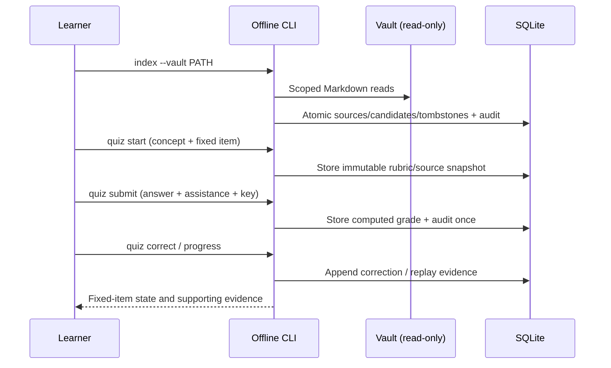

# StudyBuddy

**Having notes isn't the same as knowing.**

StudyBuddy is a local-first learning ledger for software and AI engineering learners.
Read an Obsidian vault without changing it, trace concepts to their sources, and
separate exposure from versioned, rubric-checked assessment evidence.

**Alpha · v0.2.0 / Sprint 2 · Python CLI · MIT · offline runtime**

[中文说明](README.zh-CN.md) · [Architecture](docs/ARCHITECTURE.md) ·
[Roadmap](docs/ROADMAP.md) · [Changelog](CHANGELOG.md) · [Contributing](CONTRIBUTING.md)

## Try the demo

Requires Python 3.12+ on **macOS or Linux**, SQLite with FTS5, and
[uv](https://docs.astral.sh/uv/getting-started/installation/). From this checkout:

```sh
uv sync --locked
uv run --offline python examples/demo.py
```

Only dependency installation requires network access. The demo uses original synthetic
notes, a provided synthetic answer, and temporary databases outside the vault. It
shows idempotent indexing, an explicit copied-AI event, fixed-item grading, corrections,
and JSONL restore. It removes the temporary data on exit. No model, API key, or account
is required; the project has not been published to PyPI.

Actual demo excerpt (IDs vary between fresh databases):

```text
Copied AI answer: created=True; repeated key: created=False
Synthetic fixed-item answer: score=1.0; state=assessed_once (no delayed retest)
Append-only correction: invalidate -> exposed
Append-only correction: restore -> assessed_once
JSONL round trip: projections and event history preserved
```

The demo does not pretend to wait 24 hours or demonstrate a learner's actual recall.

## What works

| Command | Result |
| --- | --- |
| `doctor --vault PATH` | Count visible Markdown files without reading bodies or creating a DB |
| `index --vault PATH` | Incrementally index SHA-256, versions, YAML, headings, Wikilinks, and tombstones |
| `concepts list [--search PHRASE]` | Source-backed `seen` candidates and literal FTS5 lookup |
| `events add` / `events list` | Explicit self-reported history with append-once keys and two timestamps |
| `quiz list` / `quiz show ID` | Nine original, versioned recall/application/transfer items over three topics |
| `quiz start` / `quiz submit` | Source-bound sessions, deterministic scores, assistance, hints, answer hashes |
| `quiz correct` / `quiz history` | Append-only invalidation/restoration and attributable history |
| `progress [--as-of TIME]` | Replay evidence, explain support, and reverse states after failed checks |
| `export` / `import` | Checked JSONL snapshot and restore into a new database |
| `migrate --backup PATH` | Explicit backup-first upgrade of a Sprint 1 database |

Every leaf command supports `--json`. `--db` is global: put it **before** the command.
There is no HTTP service, MCP adapter, review scheduler, frontend, model grader, or
learner-code execution in this release.

## Index your vault

```sh
uv run --offline studybuddy --db .local/study.sqlite3 doctor --vault /absolute/path/to/vault
uv run --offline studybuddy --db .local/study.sqlite3 index --vault /absolute/path/to/vault
uv run --offline studybuddy --db .local/study.sqlite3 concepts list
uv run --offline studybuddy --db .local/study.sqlite3 progress
```

The database must be outside the vault; each DB binds to one canonical root.
Without `--db`, use `$XDG_DATA_HOME/studybuddy/studybuddy.sqlite3`, or
`~/.local/share/studybuddy/studybuddy.sqlite3` if that variable is unset.

Upgrading a v1/Sprint 1 database requires an explicit command before reads or writes:

```sh
uv run --offline studybuddy --db .local/study.sqlite3 migrate \
  --backup .local/study-before-v2.sqlite3
```

The new backup is integrity-checked before applying schema v2. Existing backups are
never overwritten. A fresh DB starts at v2; migrating a current v2 DB is a no-op.

## Take an assessment

Copy a full `c_...` ID from `concepts list` into `STUDYBUDDY_CONCEPT_ID` and choose
an item relevant to that concept. These are fixed original questions, not questions
generated from private notes. The first session explicitly binds that concept to its
assessment topic; mixing unrelated topics on one concept is rejected.

```sh
uv run --offline studybuddy quiz list --topic retry-safety
uv run --offline studybuddy quiz show retry-recall
uv run --offline studybuddy --db .local/study.sqlite3 quiz start \
  --concept "$STUDYBUDDY_CONCEPT_ID" --assessment retry-recall \
  --idempotency-key retry-session-001 --json
```

Copy the returned `s_...` ID into `STUDYBUDDY_SESSION_ID`. Create your own answer
JSON file, selecting the listed choice keys, for example this **shape**:

```json
{"timeout":"<choice key>","identity":"<choice key>","explanation":"Optional; stored but not graded."}
```

Then submit your file with an explicit assistance declaration:

```sh
uv run --offline studybuddy --db .local/study.sqlite3 quiz submit \
  --session "$STUDYBUDDY_SESSION_ID" --answer-file .local/my-answer.json \
  --assistance independent --hints-used 0 --idempotency-key retry-answer-001
uv run --offline studybuddy --db .local/study.sqlite3 quiz history --json
uv run --offline studybuddy --db .local/study.sqlite3 progress
```

Assistance is `independent`, `assisted`, or `ai_generated`; independent answers cannot
report hints. A session accepts one answer. Use a new session for another attempt.
The same idempotency key returns the original operation; changing its semantic input
fails. Scores, evaluator versions, or a `mastered` flag cannot be supplied by the caller.

To correct a misattributed result, copy its `a_...` ID into `STUDYBUDDY_ATTEMPT_ID`:

```sh
uv run --offline studybuddy --db .local/study.sqlite3 quiz correct \
  --attempt "$STUDYBUDDY_ATTEMPT_ID" --action invalidate \
  --reason "I used external help for this attempt" --idempotency-key correction-001
```

`restore` can undo the invalidation, with a new key and reason. Original answers,
scores, and every correction remain in history. A correction cannot invent a new score.

## Understand the evidence

Candidates retain `status=seen`. The separate `learning_state` is derived using
`fixed-evidence-v1`, and references supporting attempt IDs and correction history.

| State | Required active evidence |
| --- | --- |
| `exposed` | Notes/self-reports, without an active scored result |
| `answered_with_help` | A correct assisted/AI-assisted fixed-item response |
| `assessed_once` | A correct declared-independent response; delayed recall not yet demonstrated |
| `recalled_unassisted` | Two independent recall passes; second session issued ≥24 hours after the first submission |
| `applied` | Delayed recall, then an independent application-scenario pass |
| `transferred` | Application, then an independent transfer-scenario pass in a distinct context |
| `needs_review` | An active failed check has cleared the current evidence chain |

Immediate repeats and leaving an early session open do not satisfy the delay. Assisted
successes cannot promote independent states. Invalidation replays history: removing a
success can lower state; removing a mistaken failure can recover earlier evidence.
`progress --as-of` replays results/corrections known by that timestamp, using today's
active source list rather than reconstructing a historic vault.

These are **provisional fixed-item heuristics**, not scientific mastery criteria.
Choice keys are scored deterministically; optional explanations are not evaluated.
Assistance is learner-declared, the local clock is not externally attested, and answer
keys are available in the open-source package. `applied`/`transferred` describe only
these fixed scenarios, not production coding ability. General mastery is not certified;
`verified_mastered` remains zero. Copying a note or recording a self-report never
promotes these states.

## Export and restore

```sh
uv run --offline studybuddy --db .local/study.sqlite3 export --output .local/study.ledger.jsonl
uv run --offline studybuddy --db .local/restored.sqlite3 import \
  --input .local/study.ledger.jsonl --vault /absolute/path/to/vault
```

The output and new DB must be outside the vault and must not already exist. Export
uses a consistent read snapshot; import validates the entire file before creating its
target. It preserves source identities, self-reports, assessment definitions, answers,
corrections, replay keys, and projections. The user explicitly selects the restored
vault root; the manifest does not grant filesystem authority.

Format v1 targets schema v2 and the bundled evaluator/catalog. It has a count/hash
trailer and a 64 MiB limit; every imported score is recomputed. Truncation, unknown
fields, traversal paths, changed rubrics, broken references, and inconsistent grades
are rejected. A checksum is not a signature or evidence of truthful study behavior.

Exports contain **private metadata and answers** and are not encrypted. They omit
operational audit and the rebuildable FTS cache; use SQLite's backup API for a full
DB/audit backup. See [architecture](docs/ARCHITECTURE.md) and [security](SECURITY.md).

## Design and limits



`vault.py` and `markdown.py` own scoped extraction; `indexer.py` owns reconciliation;
`assessments.py` and `catalog.py` own scored evidence; `projector.py` owns replay;
`migration.py` owns backup-first upgrades; `ledger.py` owns validated portability.
[Architecture](docs/ARCHITECTURE.md) documents tables, API examples, and tradeoffs.

Notes are read-only, UTF-8, and limited to 2 MiB. Hidden paths and all symlinks are
skipped. Metadata includes frontmatter, headings, links, hashes, and timestamps;
**note bodies are not persisted**. Invalid YAML produces a content-free warning;
unreadable/oversized/invalid-UTF-8 notes abort indexing. Exact-hash one-to-one renames
retain identity; ambiguous duplicates and rename+edit become tombstones/new sources.

This is a bounded Markdown extractor, not a full editor/parser. FTS5 `unicode61` has
no Chinese word segmentation. Same-title concepts across notes are not merged, and
renamed headings get new candidate IDs. There is no telemetry or runtime network
client. Windows, encrypted storage, large-vault performance, and hosted multi-user
operation are not covered by the alpha.

## Develop and contribute

```sh
uv sync --locked
uv run --offline ruff check .
uv run --offline ruff format --check .
uv run --offline pytest -q
uv build
uv run --offline python scripts/smoke_wheel.py
```

The suite includes **32 seeded learning histories**, persistence/idempotency, source
changes, traversal/symlinks, audit rollback, migration backups, corrupt/forged imports,
and round trips. [Validation](docs/VALIDATION.md) records actual local results; Linux/
macOS and Python 3.12/3.13 are configured in CI, with hosted results pending a GitHub push.

See [the roadmap](docs/ROADMAP.md) for the next slice and [contributing](CONTRIBUTING.md)
for small, testable improvements. If the distinction between collecting notes and
demonstrating learning is useful, try the demo, report a synthetic reproduction, or
star the project when it is on GitHub. No user counts or benchmark claims are implied.

MIT licensed. [Planning references](docs/vision/REFERENCES.md) are historical context;
referenced tutors' application code and vocabulary datasets are not bundled.
