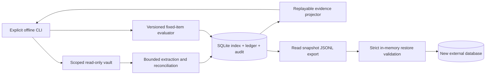

# Implemented architecture — Sprints 1–2

This describes v0.2.0. `vision/` contains future product sketches; MCP, scheduling,
frontend, LLM grading, and code execution are not shipped.

## Boundaries and ownership

The vault owns authored Markdown. StudyBuddy owns computed source metadata and
application-level append-only learning/assessment records. Local CLI invocation is
explicit authority for mutations, which validate inputs and audit in the same
transaction. There is no server authorization layer; future write-capable adapters
must enforce authorization themselves. Source text and imported files are inert data.

## Schema v2

`schema.sql` preserves the original v1 baseline. `migrations/002-assessments.sql` adds
v2 tables; fresh initialization applies both atomically. The application ID and schema
version are checked on every open. v1 reads/writes reject with an actionable migration
command. `migrate --backup` is explicit, integrity-checks a new backup, and atomically
commits DDL, version, and audit. Unknown formats/versions are refused.

SQLite uses foreign keys, WAL, `synchronous=FULL`, and a 5-second busy timeout. Read
commands open with `mode=ro` and `query_only`; values use bound parameters. Output files
are created exclusively with mode `0600`, and new parent directories request `0700`.
Existing directory permissions are not changed. Restored DBs also use WAL.

| Table | Meaning |
| --- | --- |
| `settings` | One canonical, explicitly selected vault root |
| `documents` | Current source identity/path/hash/version/metadata and deletion tombstone |
| `concepts` | Heading candidates; `seen` and `candidate` remain source properties |
| `wikilinks` / `concept_search` | Inert links and rebuildable active-title/path FTS5 index |
| `learning_events` | Self-reports, unique keys, occurred/recorded timestamps, source snapshots |
| `assessment_sessions` | Explicit concept/topic mapping, exact item/rubric snapshot/hash, issuance time |
| `assessment_attempts` | One answer per session, answer/hash, computed grade, assistance/hints, submission time |
| `assessment_corrections` | Ordered invalidate/restore records with reasons and replay keys |
| `audit_log` | Atomic mutation audit; excluded from logical JSONL exports |

Note bodies are not stored. Frontmatter, headings, links, absolute root, source hashes,
timestamps, self-reports, answers, and corrections remain private unencrypted data.

## Source reconciliation

Indexing runs one `BEGIN IMMEDIATE` transaction per complete scan, serializing writers
before reading the old index. All source/candidate/FTS/tombstone/audit changes roll back
together on failure. This favors small-vault consistency over short writer-lock time.
Every visible Markdown file is hashed; only changed/restored files are parsed again.
Touching unchanged bytes creates neither a new content version nor a learning event.

A one-to-one identical-hash pair among missing/new paths is a rename heuristic that
preserves document identity. Ambiguous duplicates and rename+edit become deletion and
addition. Source deletion retires candidates and removes search entries, preserving
historical events and assessment snapshots. Heading identity is document ID + text +
duplicate occurrence number; renaming/reordering identical headings may change identity.
There is no concept confirmation/merging or graph in this slice.

Reads reject absolute/traversal/hidden/NUL/backslash paths and open each component using
relative directory descriptors with `O_NOFOLLOW`. All symlinks are skipped. Notes must
be regular UTF-8 files ≤2 MiB. File size/mtime changes during a read cause rejection;
there is no filesystem-wide snapshot. Unreadable/oversized/invalid-encoding files abort
the scan so missing sources are not falsely tombstoned.

ATX/Setext headings exclude fences/comments, Wikilinks in code are ignored, and a
file-level candidate is used without headings. This is not complete CommonMark.
YAML uses bounded SafeLoader: ≤64 KiB, 2,048 nodes, 24 levels, no aliases. Malformed
frontmatter produces `{}` and a content-free warning; unclosed frontmatter falls
back to the filename. `unicode61` does not provide Chinese substring segmentation.

## Assessment lifecycle

1. `quiz list/show` exposes original prompts and choice keys without opening a DB.
2. `quiz start` validates an active concept and snapshots the known catalog item,
   exact rubric, evaluator, source path/anchor/line/hash/version, and system issuance
   timestamp. The first chosen topic binds that concept; later unrelated topics fail.
3. `quiz submit` accepts one structured answer, explicit assistance, and hint count.
   Scores are computed by `exact-fields-v1`: all fields correct is a pass; partially
   correct responses receive a fractional score and fail. Optional explanations are stored,
   explicitly not graded. No caller-supplied score/evaluator/mastery flag is accepted.
4. `quiz correct` appends invalidate/restore with a reason. Restore requires an active
   invalidation. Neither answers nor grades are overwritten. Every new operation and
   its audit commit atomically; identical retries return the existing operation.

Submission time is system-recorded and cannot be backdated through the CLI. Historical
self-report `occurred_at` remains separate from insertion time. Tests inject a synthetic
clock; the product has no fake-time switch. The real local clock and declared assistance
are not externally witnessed. Answer keys are public in the source package, so this is
not a cheat-resistant exam. The fixed topics do not establish production coding skill.

Sessions can still receive a historical result after their source disappears, but that
concept is omitted from the current active progress view. Stored provenance stays intact.

## Replay contract

`progress` re-evaluates stored answer/rubric consistency and calls the pure projector.
There is no mutable mastery table or cache. `status=seen` remains distinct from
`learning_state`. `fixed-evidence-v1` applies these product heuristics:

- Correct assisted/AI-assisted responses can support only `answered_with_help`.
- A correct declared-independent response supports `assessed_once`.
- Two independent recall passes support `recalled_unassisted` only when the second
  session was issued at least 24 hours after the first submission.
- A subsequently issued independent application pass supports `applied`.
- A later independent transfer pass in a different context supports `transferred`.
- Any active failed check clears the chain to `needs_review`. Assisted success cannot
  upgrade an established independent state. Earlier application/transfer attempts are
  not retroactively promoted after prerequisites become satisfied.

Corrections are applied in recorded sequence, then active attempts are replayed in
submission order with ID tie-breaking. Invalidation can remove both positive and
negative evidence; restoration reuses the original grade. `--as-of` filters by recorded
time and applies only corrections known at that cutoff. Source availability still uses
today's active index, so this is evidence replay, not vault time travel.

Responses expose supporting/invalidated attempt IDs, last assessment time, topic,
projector version, cutoff, delay, and the learner-declared independence boundary.
`verified_mastered` remains zero: broad mastery is not certified. This keeps v0.1 JSON
consumers conservative while adding meaningful fixed-item evidence and gap counts.

## JSONL portability and restore

Format v1 is manifest → typed records → count/SHA-256 trailer, targeting schema v2.
Export pins a read transaction and serializes records in deterministic order. It includes
source contexts and learning/assessment history; operational audit and FTS are omitted.
Same-root export/import/export reproduces the bytes and evidence projection.

Import requires a new target and an explicitly selected existing vault root. The
manifest's root is informational, never authorization. A ≤64 MiB file is parsed with
strict JSON: no duplicate keys, non-finite numbers, unknown fields, executable SQL,
or unrecognized table names. Type/constraint/reference/path/time/source/topic/correction
checks run in an in-memory staging DB. Every item must match the known immutable
snapshot; every stored grade is recomputed. Only then are root binding, reconstructed
FTS, and a new import audit committed into a new DB. No existing ledger is merged.

A checksum detects corruption, not authenticity. A user can control their answer history
and assistance declarations; import does not turn that into external attestation.
The current format requires known bundled item/evaluator versions. Future releases
must preserve those definitions or supply an explicit compatibility migration.

## Backup, ownership, and decisions

JSONL is a logical portability format, not an operational audit backup. For a complete
snapshot use `sqlite3.Connection.backup()`. `migrate` uses a separate reader while a
writer reservation protects the old schema; backing up the active writer itself may
wait on its transaction. Migration tests restore and re-migrate the v1 backup and
inject an audit failure to verify DDL rollback.

Stop commands before deleting a chosen database and its SQLite sidecars; history is
not reconstructable from notes. Deleting StudyBuddy data does not write to the vault.
No selective deletion CLI or encryption is supplied.

The original five concerns remain: transaction boundaries, semantic idempotency,
mtime versus learning time, historical source provenance, and scoped filesystem access.
See [read-only sources](adr/001-read-only-source.md), [SQLite](adr/002-sqlite-atomic-index.md),
[event semantics](adr/003-event-ledger.md), [migration](adr/004-backup-first-migration.md),
[fixed-item evidence](adr/005-fixed-item-evidence.md), and [JSONL](adr/006-jsonl-portability.md)
for context, alternatives, and revisit triggers.

Primary references: [Python sqlite3](https://docs.python.org/3.12/library/sqlite3.html),
[SQLite backup](https://www.sqlite.org/backup.html), [PyYAML](https://pyyaml.org/wiki/PyYAMLDocumentation),
[uv CI integration](https://docs.astral.sh/uv/guides/integration/github/).
