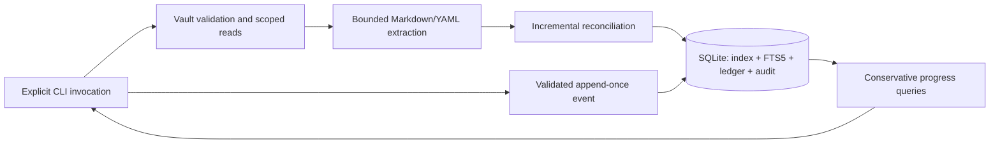

# Implemented architecture — Sprint 1

This document describes shipped code. The broader product sketches are in
`vision/` and do not imply that an assessment, scheduler, server, or UI exists.

## Boundaries



The vault owns authored Markdown. StudyBuddy owns an index derived from selected
metadata and an append-only application API for self-reported learning events.
The runtime has no network integration or note/code execution path. A future
write-capable MCP adapter must authorize on the server; CLI invocation is the
explicit authority for today's local mutations.

## Storage

`schema.sql` initializes format version 1 and an application ID. An unrelated or
newer database is rejected instead of being silently adopted. There are no schema
upgrades yet. SQLite uses foreign keys, WAL, `synchronous=FULL`, and a 5-second busy
timeout. Values are bound through parameters; dynamic SQL clauses are fixed code.

| Table | Ownership and meaning |
| --- | --- |
| `settings` | One canonical `vault_root` per database |
| `documents` | Persistent document identity, unique relative path, latest hash/version, metadata, tombstone |
| `concepts` | Per-document heading candidates, `seen`, provenance, first discovery and current indexing time |
| `wikilinks` | Parsed targets, aliases, anchors, and lines; never followed to read arbitrary files |
| `concept_search` | Rebuildable FTS5 view of active heading titles, paths, and anchors |
| `learning_events` | Caller-supplied observations, unique keys, source snapshots, two distinct timestamps |
| `audit_log` | Successful vault binding, changed-index summaries, and newly appended events |

Note bodies are never persisted, but full frontmatter, headings, and links are.
The database is local and private metadata is not anonymized or encrypted.
Queries open the database in read-only mode. `doctor` never opens a database.
An unchanged index or event replay does not append a mutation audit entry.

## Five decisions and their pitfalls

1. **One indexing transaction per scan.** `BEGIN IMMEDIATE` serializes writers
   before the existing index is inspected. Bind, source updates, candidate updates,
   FTS, tombstones, and audit either commit together or roll back together. This
   favors correctness for small local vaults; it holds a write lock during reads and
   can delay event recording. A failing scan must not produce mass tombstones.
   If measurements show unacceptable lock duration, stage file snapshots and
   revalidate an index generation before applying bounded batches. Schema statements
   are executed individually because `executescript()` can implicitly commit.
2. **Idempotency includes semantic conflict checks.** A unique key and the event
   are committed together with audit. A replay returns the original event only
   when concept, kind, and any explicitly supplied normalized time agree. When
   time is omitted, replay uses the original time rather than generating a conflict
   from a new clock reading. This is a local database guarantee, not a distributed
   exactly-once claim.
3. **File mtime is not learning time.** `source_mtime_ns` is observed alongside
   the content version; hash changes increment `content_version`. Touching unchanged
   bytes does not update the logical index or create events. `occurred_at` is an
   explicit timezone-aware user report normalized to UTC; `recorded_at` is the
   system's insertion time. Neither proves how long somebody studied.
4. **Provenance outlives the source.** Candidate IDs use document ID plus heading
   text and occurrence number. Body edits keep unchanged headings' IDs. Events
   snapshot document ID, path, anchor, line, content hash, and version at insertion.
   A rename updates current paths, while existing event snapshots retain old ones.
   A deletion retires candidates and removes active search entries without deleting
   historical events. The index is not a complete archive of old note contents.
5. **Validate at the filesystem boundary.** The database is checked to be outside
   the chosen vault before indexing. Reads reject absolute paths, `..`, hidden path
   components, backslashes, and NULs. Each component is opened relative to a directory
   descriptor with `O_NOFOLLOW`, so checking `resolve()` and then following a swapped
   symlink is avoided. All symlinks are skipped, including internal ones. macOS/Linux
   support is intentional; a Windows adapter needs equivalent guarantees and tests.

## Reconciliation rules

Every scan reads and hashes visible Markdown, but only changed or restored sources
are reparsed. Candidates without headings fall back to frontmatter title or filename.
ATX/Setext headings are extracted outside fenced code and HTML comments; Wikilinks
inside inline/indented code are ignored. This is not a complete Markdown AST.

An identical-hash one-to-one pair among missing and new paths retains document
identity. This is a conservative heuristic, not proof of a filesystem rename.
Ambiguous duplicate matches and rename+edit become deletion+addition. Restoring a
previous path reactivates its document. Each source remains separate; no automatic
cross-document concept merging, user confirmation, or prerequisite graph is shipped.
Renaming a heading creates another candidate. Reordering identical headings can
change their occurrence identity; line numbers distinguish duplicate source spans.

Invalid frontmatter is stored as `{}` with a generic warning; body extraction can
continue after a closing delimiter. Unclosed frontmatter uses a file-level candidate.
SafeLoader is further bounded to 64 KiB of YAML, 2,048 nodes, 24 levels, and no aliases.
The note limit is 2 MiB. A read/encoding/size failure rolls back reconciliation.
Files changing during a read are rejected when their size/mtime changes. There is
no filesystem-wide snapshot: concurrent user edits may require another scan.

## Evidence semantics

All six event kinds are `self_reported`, including recall, practice, and transfer
attempts. They cannot set mastery. The schema constrains candidate status to `seen`;
the progress response explicitly advertises `assessment_available=false` and
`verified_mastered=0`. These are deliberate Sprint 1 limits, not fake assessment logic.

An independent assessment system must add attributable outcomes, independence/hints,
rubric and evaluator versions, and replayable state derivation. It must preserve
failed outcomes and support corrections instead of overwriting a learned flag.
See [ADR-003](adr/003-event-ledger.md) and the [roadmap](ROADMAP.md).

## Ownership, backup, and deletion

The default database is under XDG data home (or `~/.local/share`); `--db` can choose
another external file. Newly created database files use mode `0600`; newly created
parent directories request `0700`. Existing directory permissions are not changed.
Your OS account controls local access; the application is not an OS security sandbox.

Use SQLite's `Connection.backup()` for a consistent ledger backup. Example, from the
repository root after commands have finished:

```python
import sqlite3

with sqlite3.connect("file:.local/study.sqlite3?mode=ro", uri=True) as source:
    with sqlite3.connect(".local/study-backup.sqlite3") as destination:
        source.backup(destination)
```

Restoring means selecting a copy of that backup with `--db` at the same vault root;
the root binding is retained. Vault relocation is not automated. Stop commands before
deleting the chosen database and its `-wal`/`-shm` files. This deletes all local events,
candidates, metadata, and audit history without writing to the vault. No event
export/import or selective deletion CLI is provided in this slice.

## Primary implementation references

- [Python 3.12 sqlite3 transaction control](https://docs.python.org/3.12/library/sqlite3.html#transaction-control)
- [SQLite synchronous settings](https://www.sqlite.org/pragma.html#pragma_synchronous)
- [PyYAML safe loading](https://pyyaml.org/wiki/PyYAMLDocumentation)
- [uv's GitHub Actions integration](https://docs.astral.sh/uv/guides/integration/github/)

The current implementation uses PyYAML as a dependency; no referenced tutor application's
source code or vocabulary datasets have been copied into the project.
