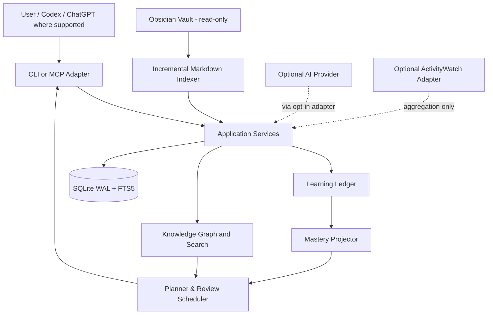

> Planning context adapted from the supplied blueprint. This describes future product scope, not shipped features. See [current roadmap](../ROADMAP.md) and [implemented architecture](../ARCHITECTURE.md). Referenced versions, licenses, and community statistics are historical planning notes and must be checked before reuse.

# Architecture and design decisions (v0.1)

## Principle: source ownership and clear bounded contexts

- **Obsidian Vault** owns human-authored notes (plain Markdown).
- **Knowledge Index** owns computed source metadata (hash, path, headings, relationships) and may be rebuilt.
- **Learning Ledger** owns immutable observations and assessment events, their provenance, and manual corrections.
- **Mastery Projector** owns derived per-concept state and confidence based on ledger (replayable).
- **Planner** owns goal constraints and generated/dismissed action proposals.
- **Review Scheduler** owns atomic recall items and scheduled due dates.
- **Model Adapter** is optional; agent orchestration must never be the only mechanism enforcing write constraints.

## Local deployment



**SQLite first:** low deployment cost, single Mac, human-readable SQL, strong transactions for single-user use, FTS5. Avoid unnecessary embeddings for small vaults; start exact/source/link and lexical retrieval, then benchmark optional embedding rerank. Once there is measured contention or a hosted multi-user requirement, migrate storage behind interfaces to PostgreSQL. Do not assume SQLite WAL allows unlimited concurrent writers.

## Bounded component interfaces

```python
class NotesSource(Protocol):
    def list_changed(self, cursor: str | None) -> list[NoteVersion]: ...
    def read(self, note_id: str) -> str: ...


class LearningEventRepository(Protocol):
    def append_once(self, event: LearningEvent) -> bool: ...
    def list_for_concept(self, concept_id: str) -> list[LearningEvent]: ...


class MasteryEvaluator(Protocol):
    def project(self, events: list[LearningEvent]) -> MasterySnapshot: ...


class QuestionSource(Protocol):
    def get_for(self, concept_id: str, difficulty: str) -> Question: ...
```

Types above are **design sketches**, not shipped implementations. Keep interfaces small; do not create adapters without a real second implementation/test fake.

## Tables (migration target, conceptual)

- `source_documents(id, connector, path, sha256, mtime, indexed_at, status)`
- `source_spans(id, document_id, anchor, excerpt, content_hash)`
- `concepts(id, canonical_name, domain, created_at)`
- `concept_sources(concept_id, source_span_id, relation, status)`
- `concept_edges(from_concept, to_concept, relation, status)`; `relation=prerequisite` should be cycle-checked.
- `learning_events(id, idempotency_key UNIQUE, user_id, concept_id, event_type, payload_json, occurred_at, recorded_at, source_ref, provenance_kind)`
- `mastery_snapshots(user_id, concept_id, state, confidence, evidence_count, last_verified_at, projector_version)`
- `assessment_items(id, concept_id, kind, prompt, rubric_json, source_ref, version)`
- `assessment_attempts(id, item_id, user_id, submitted_at, answer, outcome_json, grader_version, assistance_level)`
- `goals(id, target, deadline, priorities_json, weekly_budget_minutes)`
- `plan_actions(id, goal_id, concept_id, scheduled_for, status, reason_json, accepted_at)`
- `vocabulary_items(id, lemma, phrase, source, language, attribution)`
- `review_records(id, vocabulary_item_id, user_id, rating, completed_at, scheduler_version)`
- `outbox(id, event_id, type, payload_json, status, attempts, available_at)` (when async processing exists)

Separate source existence, recorded learning event, and derived mastery: this avoids claiming 'mastered' on import, prevents rewrites by model output, supports re-evaluation when grading logic improves.

## Indexing and sync

1. Local app requests scoped access to chosen vault folder. By default read-only OS permissions if feasible.
2. Walk allowlisted Markdown files; ignore `.obsidian`, hidden folders and private patterns configured by user; never follow symlinks outside vault.
3. For each file compute SHA-256, parse frontmatter/headings/wikilinks, create consistent source span IDs. Persist in a single transaction per file. Only changed files get reindexed.
4. Handle rename/delete with tombstones; keep ledger history but mark broken provenance references rather than pretending deleted notes still exist.
5. Do not use file mtime as study activity duration. Learning events have independent timestamps.
6. Optional Obsidian CLI or Local REST API adapters later; file access is sufficient for a local headless indexer. CLI is official and can append daily notes if user approves.

## Assessment / mastery rules

**Not a psychological diagnosis.** `seen` is merely a source observation. Mastery state is derived from answer attempts, explanation rubrics and test results. A deterministic v0 algorithm could require two unassisted successes with a minimum delay to label `recalled`; `applied` needs validated task, `transferred` needs distinct task context. These are provisional product heuristics to test, not scientific thresholds.

Record evidence used, the grading rubric, model name (if applicable), version, and hints. Use LLM grading only with rubrics and controls; low confidence => manual review or unknown. Reviews may lower previously high confidence. Distinguish `unknown` from `false` and `missing` from `zero`.

FSRS can schedule vocabulary/atomic facts; do not naively equate FSRS recall probability to mastery of software architecture or performance in new programming tasks.

## Adaptive daily queue v0

Use transparent rule-based ranking, not a learned black-box optimizer. Candidate score may combine goal relevance, remaining deadline time, evidenced gap, review urgency, prerequisites, estimated effort and explicit learner preferences. Never treat observed screen time as proof of learning. Return at most: 1 main task, 1 review, 1 two-minute fallback. Include explanation/evidence and allow override.

## Scaling roadmap (interview-relevant, not premature)

**Local (1 user)**: SQLite + FTS5 + background in-process batch on demand; separate processes only if needed. Measure latencies first.

**Hosted (multi-user)**: stateless FastAPI instances behind a load balancer; PostgreSQL transactions and RLS/tenant-scoped access; Redis optional for measured cache hotspots; queue (SQS/RabbitMQ) for jobs; outbox ensures the change event is committed alongside state; idempotent workers and retry/backoff, dead-letter visibility; per-user/tenant partitioning; optimistic `version` checks; read model projection/event replay; backups and restore tests. Use Locust/k6 to *measure* actual throughput and p95 before claiming production scalability. No need to introduce Kafka solely as a résumé keyword.

## Security and trust

- Model responses, notes and downloaded text are **untrusted content**, not execution instructions; guard against prompt injection on tool input.
- Obsidian read-only by default. Any write action requires explicit user consent, path validation, and a preview/diff.
- Credentials never passed into code execution sandbox; no Docker socket. First-party tool adapter enforces authority, not prompt wording.
- ActivityWatch integration OFF by default; aggregate categories/durations locally, redact private window titles, exclude employer activity and sensitive apps.
- Sleep/calendar imports OFF by default, with granular permissions and user-controlled deletion. No psychological diagnoses or medical inferences from activity data.
- Never auto-export personal vault contents to an LLM provider; BYO-LLM opts in per connector and data scope.
- No external telemetry by default. Local OpenTelemetry tracing may record IDs, timing and counts, not raw source text.
- Data portability: JSONL learning events, CSV cards, Markdown source links, backup/restore/import, and delete requests.

## Test plan

- Unit: parsers, date semantics, planning rules, mastery projection, FSRS adapter, duplicate-event handling.
- Integration: 100+ fixtures, renamed notes, deleted notes, Unicode and CJK, links, malformed frontmatter, concurrent indexing and user assessments.
- Resilience: process crash between event append and index update; reindex idempotency; corruption-free rebuild; versioned migrations.
- Security: path traversal and symlinks, injected tool instructions in notes, API auth tests when deployed, screenshots/private app exclusion.
- Evaluation: note-span Recall@K with 50 labeled queries; 25 concept assessment histories; false mastery rate; review adherence and delayed independent recall.
- Performance: p50/p95 source indexing and query times; no arbitrary SLO claims before benchmarking.

## ADR seeds

- ADR-001: Obsidian external source of truth, local read-only index; no duplicate editor.
- ADR-002: SQLite and FTS5 for v0; Postgres migration path.
- ADR-003: Event ledger vs mutable learned flags.
- ADR-004: MCP as port/adapter, not the domain model or autonomous learning loop.
- ADR-005: No learning-styles personality labels; behavior-based diagnostics.
- ADR-006: Independent exercise evidence required for 'mastered'.
